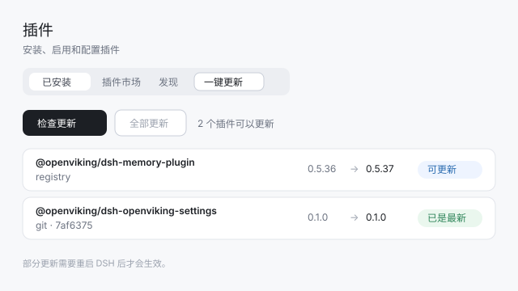

# 一键插件更新（DSH 插件）

在 DeepSeek Harness 的 **【设置 → 插件】** 里新增一个 **「一键更新」** 标签页：
一次检查所有已装插件有没有新版本，一键全部升级。



## 它解决什么

DSH 自带的插件页面能**逐个**插件检查和更新，但：

- **没有批量**——插件一多就得一个个点；
- **市场没收录的插件查不到**——更新入口依赖插件出现在插件市场索引里；
- **Git 钉在提交上的插件要手填 40 位 commit**。

本插件把这三件事一次解决：

| 能力 | 做法 |
| --- | --- |
| 批量检查与更新 | 对宿主判定为「可更新」的 profile 依赖逐个查询，再按顺序全部升级 |
| 不依赖市场索引 | 版本直接问包 registry（`pluginManager.listVersions`），市场收录与否不影响 |
| Git 源自动跟进 | 解析 profile 里的 Git 来源，取上游 HEAD 提交与该提交上的版本，自动生成钉住完整 commit 的 spec |
| 状态如实呈现 | 每个插件显示已装版本、最新版本与结论（可更新 / 已是最新 / 不能更新 / 无法检查） |

## 用法

1. 打开 **设置 → 插件 → 一键更新**；
2. 点 **检查更新**（首次打开会自动检查一次）；
3. 点 **全部更新**。

更新过程逐条显示宿主报告的阶段（checking / removing / installing / restoring）与结果。
部分更新需要**重启 DSH** 后才会生效。

## 它不做什么

- 不直接改 profile 的 `package.json`，不自己跑 pnpm：安装、兼容性判断、版本豁免、
  失败回滚全部交给官方 `pluginManager` 服务；
- 不动 DSH 自带插件（那些随应用升级）；
- 不绕过宿主的兼容性检查——被判定为与当前 DSH 不兼容的版本不会被选中。

## 实现要点

插件只有浏览器半（`exports["./client"]`）。宿主半什么都不做，它只是让这个 bundle
在 profile 里有一行。

| 官方 API | 用途 |
| --- | --- |
| `ctx.remote.pluginManager.listBundles()` | 列出已装且被判为可更新的 bundle（`update: 'registry' \| 'git'`） |
| `ctx.remote.pluginManager.listVersions(name, {})` | 问 registry 有哪些更新版本；宿主已做兼容性检查与豁免读取 |
| `ctx.remote.pluginManager.updateBundle(name, version, { spec, requestId })` | 执行更新 |
| `ctx.remote.$on('plugin-manager/update-state', …)` | 更新进度 |

Git 源的 bundle 由 `listVersions` 明确拒绝（"installed from Git, which lists no versions"），
所以这一类插件自己解析来源：读 `https://api.github.com/repos/<owner>/<repo>/commits` 取 HEAD，
读该提交上的 `package.json` 取版本，再比较语义化版本。

界面通过 `plugins.tab` 插槽挂到内置插件页面上（与「发现」标签页同一机制）。

## 安装

```sh
# 从本目录安装（开发）
dsh plugin --profile desktop add "F:/path/to/dsh-plugin-update-all"

# 或从插件市场安装（发布后）
dsh plugin --profile desktop add @dsh-community/dsh-plugin-update-all
```

也可以在 **插件 → 添加插件** 里选本地目录。

## 开发

```sh
cd tools
pnpm install
node build-client.mjs     # src/client.tsx -> client.js
node test-store.mjs       # 纯逻辑自测（Git 来源解析、版本比较）
```

## 许可

MIT
