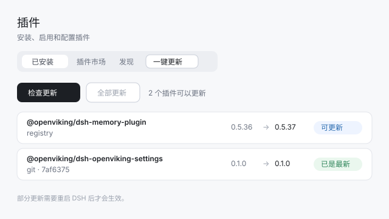

# Update All (DeepSeek Harness plugin)

Adds an **"Update All"** tab to the DeepSeek Harness **Settings → Plugins** page:
check every installed plugin for a newer version in one pass, then update them all
with one click.



## Why

The built-in Plugins page can check and update plugins **one at a time**, but:

- there is **no batch action**;
- a plugin the market index does not list has **no update entry** at all;
- a plugin pinned to a Git **commit** asks you to type a 40-character SHA.

This plugin solves all three:

| Capability | How |
| --- | --- |
| Batch check and update | Every profile dependency the Host marks updatable is queried, then updated in order |
| No market index required | Versions are read from the package **registry** (`pluginManager.listVersions`), not from a market index |
| Git sources follow upstream | The profile's Git source is parsed, the upstream HEAD commit and its version are read, and a spec pinned to a full commit is handed to the Host |
| Honest status | Each plugin shows its installed version, the newest version, and the verdict (update available · up to date · cannot update · cannot check) |

## Usage

1. Open **Settings → Plugins → Update All**;
2. Press **Check for updates** (the tab checks once when it opens);
3. Press **Update all**.

Each update reports the stage the Host names (checking / removing / installing / restoring)
and its outcome. Some updates only take effect after a **restart of DSH**.

## What it does not do

- It never writes the profile's `package.json` and never runs pnpm itself:
  installation, compatibility checks, version exemptions and failure rollback all
  belong to the official `pluginManager` service;
- it never touches the plugins DSH ships (those come with the application);
- it never bypasses the Host's compatibility check — a version that does not accept
  the running DSH is never selected.

## Implementation notes

The plugin is browser-half only (`exports["./client"]`); the host half does nothing but
give the bundle a row in the profile.

| Official API | Use |
| --- | --- |
| `ctx.remote.pluginManager.listBundles()` | The installed bundles the Host marks updatable (`update: 'registry' \| 'git'`) |
| `ctx.remote.pluginManager.listVersions(name, {})` | The newer versions a registry offers; the Host already checks compatibility and reads the profile's version exemptions |
| `ctx.remote.pluginManager.updateBundle(name, version, { spec, requestId })` | Runs the update |
| `ctx.remote.$on('plugin-manager/update-state', …)` | Update progress |

Every Remote call answers with an **envelope**: `{ ok, value, error }`. Unwrap it before
using the result.

Git bundles are refused by `listVersions` ("installed from Git, which lists no versions"),
so this plugin handles them itself: read
`https://api.github.com/repos/<owner>/<repo>/commits` for the HEAD commit, read that
commit's `package.json` for the version, compare semver, and let the Host install the
pinned commit.

The tab is contributed through the `plugins.tab` slot, the same mechanism the built-in
"Discover" tab uses.

## Install

```sh
# From a local directory (development)
dsh plugin --profile desktop add "F:/path/to/dsh-plugin-update-all"

# Or from a plugin index, once published
dsh plugin --profile desktop add @dsh-community/dsh-plugin-update-all
```

You can also pick a local directory in **Plugins → Add plugin**.

## Development

```sh
cd tools
pnpm install
node build-client.mjs     # src/client.tsx -> client.js
node test-store.mjs       # self-test for the pure logic (Git source parsing, version compare)
```

## License

MIT
